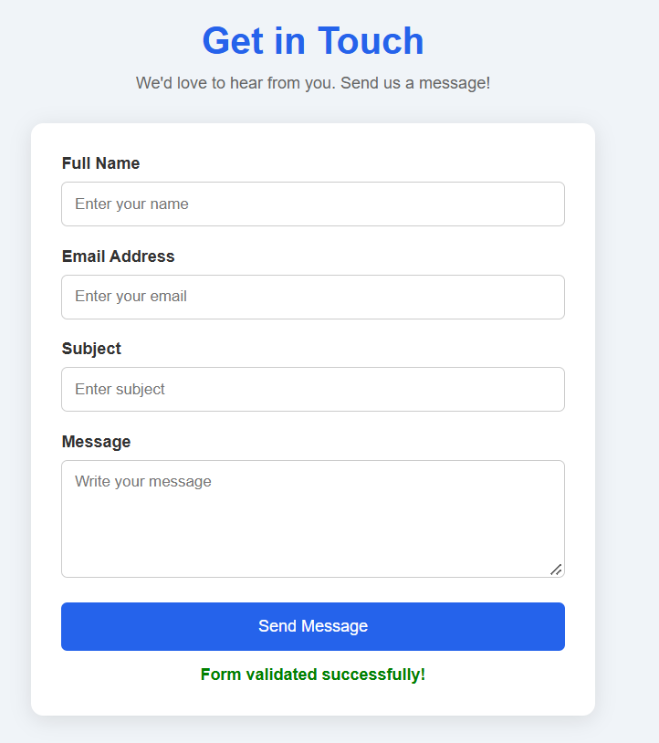

# Contact Us Page

## Project Overview

A responsive Contact Us page developed as part of
the Week 1 Git and GitHub collaboration assignment.

## Technologies Used

- HTML5
- CSS3
- JavaScript
- Git and GitHub

## Features

- Responsive contact form
- Name, email, subject and message fields
- Required field validation
- Explicit email format validation using Regex
- Success and error messages using CSS classes
- Automatic form reset after successful validation
- Safe DOM element handling

## How to Run

1. Clone the repository.
2. Open the project folder in VS Code.
3. Open index.html in a browser or use Live Server.

## Screenshots

## Testing Notes

The following test cases should be verified:

| Test Case | Expected Result |
|-----------|-----------------|
| Empty fields | Submission prevented |
| Invalid email | Validation error |
| Whitespace-only fields | Error message |
| Valid form details | Success message |
| Successful validation | Form resets |
| Mobile screen | Responsive layout |

## Pull Request and Collaboration

### Branch Details

- Base branch: main
- Feature branch: pull-requests-collaboration-week1-39

### Pull Request Summary

Implemented a responsive contact page with client-side
form validation, feedback messages and documentation.

### Review Feedback

The following improvements were requested:

- Add explicit email format validation.
- Add required attributes to form fields.
- Avoid repeated DOM element lookups.
- Replace inline styling with CSS classes.
- Add null checks for DOM elements.

### Follow-up Changes

- Implemented Regex-based email validation.
- Added native HTML required field validation.
- Cached DOM elements in constants.
- Added reusable validation feedback function.
- Applied error and success CSS classes.
- Added null checks for safe script execution.

### Merge Status

Pending final review and squash merge.

## Limitations

This is a frontend demonstration. No backend,
database or email delivery service is connected.
